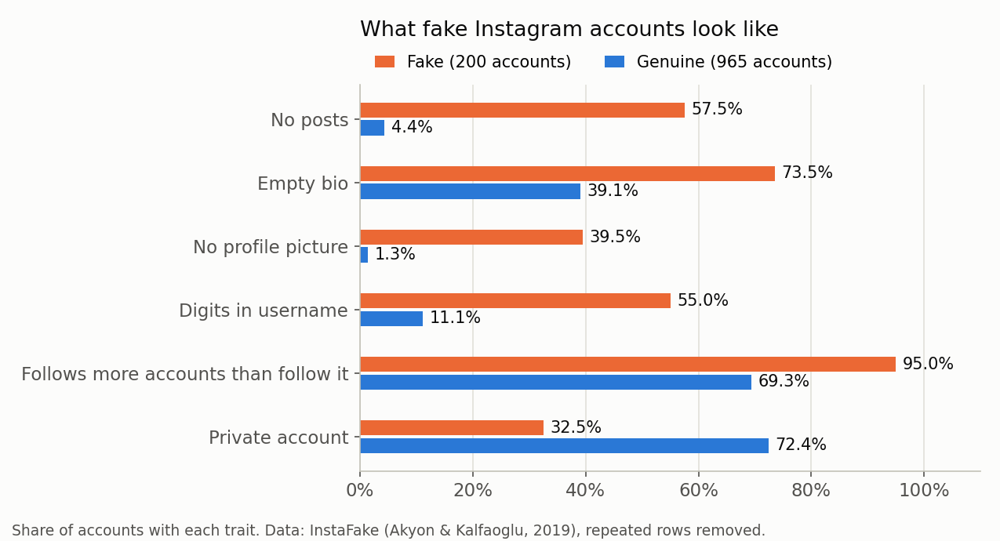
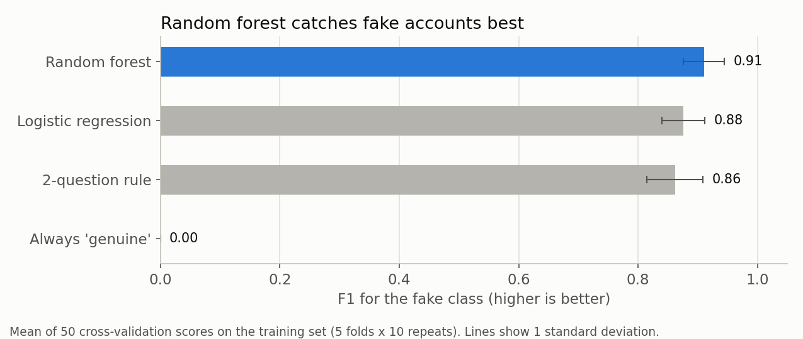
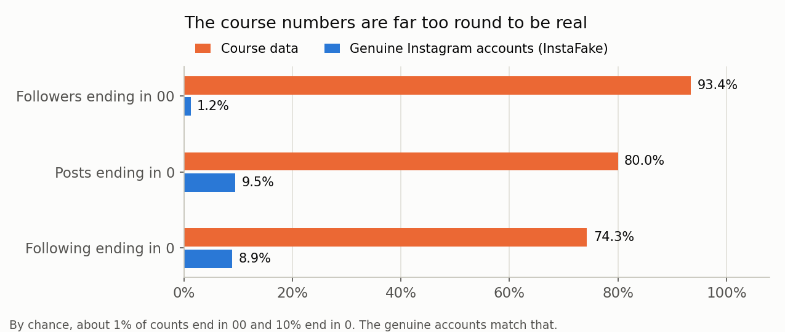

# Instagram Fake Account Detection

Two notebooks that go from a course exercise to a tested machine-learning model:

1. **Part 1: Is the course data real?** I parse a text file of 107 Instagram profile cards from a course, fix the parser, clean the data and answer the course's questions. Then I test whether the data is real. Most of it is not: 93% of its follower counts end in "00", against 1.2% for genuine Instagram accounts.
2. **Part 2: Detecting fake accounts on real data.** On 1,165 hand-labelled Instagram accounts (the InstaFake research dataset), a random forest reaches F1 0.91 for the fake class in cross-validation. On 233 accounts it had never seen, it caught 34 of 40 fakes and wrongly flagged 2 of 193 genuine accounts.



## Results

### Part 2: Fake account detection

Cross-validation = repeated 5-fold cross-validation (10 repeats, 50 scores) on the 932 training accounts. The test set (233 accounts, 40 fake) was used once, at the end. Precision, recall and F1 are for the fake class.

| Model | Precision | Recall | F1 | ROC-AUC |
|---|---|---|---|---|
| Always "genuine" (cross-validation) | 0.000 | 0.000 | 0.000 | 0.500 |
| 2-question rule (cross-validation) | 0.857 | 0.872 | 0.862 | 0.940 |
| Logistic regression (cross-validation) | 0.895 | 0.861 | 0.876 | 0.985 |
| Random forest (cross-validation) | 0.908 | 0.915 | 0.910 | 0.991 |
| **Random forest (test set, run once)** | **0.944** | **0.850** | **0.895** | **0.993** |



**Key findings**
- **Accuracy would have been misleading.** Only 17.2% of the accounts are fake, so a model that always says "genuine" is right 82.8% of the time and catches no fakes. I measured precision, recall, F1 and ROC-AUC instead.
- **The strongest signal is the follower / following ratio.** The median fake account follows about 1,450 accounts and has about 30 followers. A depth-2 decision tree found a 2-question rule: *0.16 followers or fewer per account followed → fake; otherwise, no profile picture → fake.* That rule alone reaches F1 0.862.
- **The random forest is the best model.** It had a higher F1 than the rule in 43 of 50 cross-validation folds, and it ranks accounts much better (ROC-AUC 0.993 vs 0.947 on the test set). On the small test set the rule's F1 was slightly higher (0.911 vs 0.895): it caught 2 more fakes and wrongly flagged 1 more genuine account, a gap within noise.
- **Its mistakes have a pattern.** The 6 fakes it missed don't mass-follow (follower / following ratios from 0.18 to 8.0), so profile numbers alone can't catch them. Activity data such as posting times and comments would be needed.
- **The cut-off is a business choice.** At 0.5, precision and recall are both about 0.91. A cut-off of 0.3 catches 95.6% of fakes, but 15% of the flagged accounts are then genuine (cross-validated on the training set).

**Context:** the paper that released the dataset reports macro-averaged F1 between 83.8% and 89.0% without oversampling (its Table VII), using 5 of these features and a 70/30 split. This forest's macro F1 on the test set is 0.937. The setups differ, so this is context, not a head-to-head comparison.

### Part 1: The course data

| Course question | Answer (105 unique profiles) |
|---|---|
| Who has the most posts? | `startuphub_blr`, 2,300 posts |
| Who has the most followers? | `real_account_2`, about 681,000 (Instagram shows "681K") |
| Who follows the most people? | `bangalore_tech_bro`, 890 following |
| How many people? | 105 unique profiles (107 cards, 2 usernames repeated) |
| How many categories? | 34 labels, grouped into 9 groups |

**Is the data real?** The course described these profiles as Instagram followers of OpenAI. Three checks say most of them were made up, probably generated for practice:

- 97 of 105 profiles (92%) mention Bangalore or a Bangalore area.
- 11 profiles link to a Google search instead of a website.
- 71 of 76 follower counts (93.4%) end in "00". For 892 genuine accounts from InstaFake it is 1.2%, close to the 1% expected by chance.



So the course file is fine for practising parsing, but any finding about "OpenAI's followers" from it would be false. That is why Part 2 uses real, labelled data.

**What I fixed in the course code**
- It read only a 13-profile sample file. Now all 107 cards are parsed, and the 2 repeated usernames are removed.
- It always took line 6 of a card as the category, but the category line is optional on Instagram. Now a line counts as a category only if it looks like one (1 to 3 plain words), and the parser is tested on made-up cards.
- It converted "22.4K" with `int()`, which cuts off decimals: `int(32.3 * 1000)` gives 32299. Now it uses `round()`.
- Its "13 categories" included "Unknown" and a bio line. Now: 34 labels, grouped into 9 groups.
- It stored the running maximum in a variable called `max`, which overwrites Python's built-in `max()`, and printed only the username. Now pandas `idxmax()` returns the account with its value, and ties are checked.

## How it works

**Part 1** (`part1_course_profiles.ipynb`)
1. Split the text file into cards and parse each card into a row: username, posts, followers, following, name, category, bio and link.
2. Remove repeated usernames, group the category labels and answer the course's questions.
3. Test the data: location of the profiles, their links, and how often the counts end in 0 or 00 compared with genuine accounts.

**Part 2** (`part2_fake_account_detection.ipynb`)
1. Load InstaFake, remove 29 repeated rows (so no account can be in both training and test data) and compare fake with genuine accounts.
2. Add two features: follower / following ratio and the share of digits in the username.
3. Lock away a stratified 20% test set. Compare four models with repeated cross-validation: always "genuine", a depth-2 decision tree, logistic regression (log-transformed, scaled features) and a random forest.
4. Test the best model once, then explain it: permutation importance, every mistake, and the precision / recall trade-off of the cut-off.

## Project structure

```
├── part1_course_profiles.ipynb         # Part 1: parsing, cleaning, "is the data real?"
├── part2_fake_account_detection.ipynb  # Part 2: fake account detection
├── data/
│   ├── course_profiles.txt             # course data: 107 profile cards (3 real-looking accounts anonymised)
│   └── instafake/
│       ├── fakeAccountData.json        # InstaFake: 200 fake accounts
│       ├── realAccountData.json        # InstaFake: 994 genuine accounts
│       └── SOURCE.md                   # source, citation and license
├── images/                             # charts saved by the notebooks
├── requirements.txt
└── README.md
```

## Run it

```
pip install -r requirements.txt
jupyter notebook
```

Open each notebook and choose **Kernel → Restart & Run All**. Part 2 takes a minute or two. The random seed is fixed (42), so every run gives the same numbers. I checked this with pandas 1.5 to 3.0 and scikit-learn 1.2 to 1.9.

## Data and credits

- **Course data:** the Instagram profile project from CodeWithHarry's *Ultimate Job Ready Data Science* course. `course_profiles.txt` is the course file `finaldata.txt`, except that 3 cards which look like real people or organisations have their username, name and bio replaced by placeholders (`real_account_1` to `real_account_3`). Their numbers and categories are unchanged.
- **InstaFake dataset:** F. C. Akyon and M. E. Kalfaoglu, *Instagram Fake and Automated Account Detection*, 2019, [arXiv:1910.03090](https://arxiv.org/abs/1910.03090). Data from [github.com/fcakyon/instafake-dataset](https://github.com/fcakyon/instafake-dataset), used unchanged under [CC BY-NC 4.0](https://creativecommons.org/licenses/by-nc/4.0/). See `data/instafake/SOURCE.md`.
- **My work:** the tested parser, the data checks (including the round-number test), the cleaning, and the whole of Part 2: features, model comparison, evaluation and error analysis.

## Limitations and next steps

- The InstaFake data is small (200 fakes) and from 2018. Fake accounts change over time, so a real system would need fresh data and regular re-training.
- The labels are the dataset authors' manual judgment, so the model learns their idea of "fake".
- Profile numbers can't catch fakes that look like quiet genuine accounts. Next: activity features (posting times, likes and comments per post), which the same repository provides in its automated-account dataset.
- The forest uses default settings. Next: tune the number of trees and tree depth with cross-validation.
